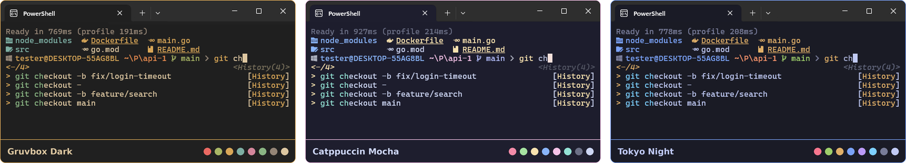
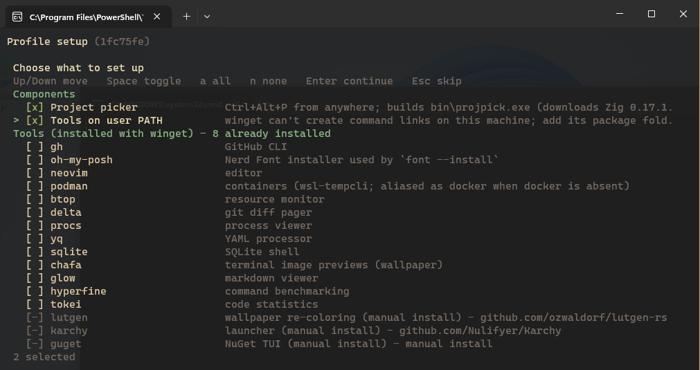
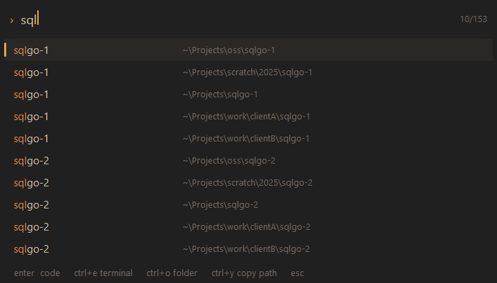

<div align="center">

# powershell-profile


[]()


A fast PowerShell 7 profile for Windows: a themed prompt, Unix-style editing, fuzzy everything, and a project switcher one keystroke away.
</div>

## Overview

`powershell-profile` turns a stock Windows 11 terminal into a quick, keyboard-driven shell. It opens in about 0.6 seconds, even on machines with real-time antivirus scanning. It works the way you expect from bash or fish: emacs keys, `grep`/`sed`/`less`, `ls` with icons, fuzzy history. Press <kbd>Ctrl</kbd>+<kbd>Alt</kbd>+<kbd>P</kbd> anywhere to jump into any project on your machine.

Clone it into your PowerShell folder and open a new terminal. A built-in setup takes care of the rest, and keeps it in shape every time you `git pull`.

<div align="center">



<sub>Gruvbox Dark · Catppuccin Mocha · Tokyo Night, three of the 40 built-in themes</sub>

</div>


## Features

| | Feature | Description |
|:-:|---------|-------------|
| ⚡ | **Fast startup** | Ready in ~600 ms with Defender real-time protection on, of which ~385 ms is PowerShell itself. The first terminal after a reboot opens in under a second, down from 6–8 s with the previous version |
| 🗂️ | **Project picker** | <kbd>Ctrl</kbd>+<kbd>Alt</kbd>+<kbd>P</kbd> from any app opens a fuzzy list of every project on your machine in ~3 ms. Open it in your editor, a terminal, or Explorer |
| 🧭 | **`z` jumps** | `z api` jumps to a project by name with Tab completion; `zi` picks one with fzf |
| 🎨 | **One theme everywhere** | `theme` recolors Windows Terminal, Alacritty, Kitty, WezTerm, Ghostty, VS Code, File Pilot, browsers, the Windows accent, the prompt and the picker at once, from 40 palettes |
| 🔤 | **Nerd Fonts** | `font` switches the terminal font everywhere; `font --install` installs new ones |
| 🐧 | **Unix feel** | Emacs keybindings, `grep`/`sed`/`awk`/`less`/`ssh` from Git for Windows, `touch`, `mkcd`, `watch`, `time`, `sudo` |
| 🔍 | **Fuzzy everything** | <kbd>Ctrl</kbd>+<kbd>R</kbd> history, <kbd>Ctrl</kbd>+<kbd>T</kbd> files, history predictions as you type, zsh-style Tab menu |
| 🧰 | **Guided setup** | First run and every update run `profile-setup`: optional tools in a checklist, the picker built from source, old leftovers cleaned up |
| 🔗 | **winget without links** | Tools installed with winget work even where company policy blocks the links winget normally creates |
| 🔄 | **Quiet updates** | Checks for profile and PowerShell updates once a week in the background; never delays startup |


## Requirements

To run:
- Windows 10 or 11 (tested on Windows 11)
- [PowerShell 7.2+](https://github.com/PowerShell/PowerShell)
- [Git](https://git-scm.com/) to clone and update it

Everything else is optional and offered by setup: fzf, eza, bat, fd, ripgrep and more (through winget), a [Nerd Font](https://www.nerdfonts.com/) for the prompt icons, and Zig 0.17 to build the project picker (downloaded automatically if you don't have it).


## Installation

```powershell
git clone https://github.com/Nulifyer/powershell-profile.git "$HOME\Documents\PowerShell"
```

Open a new terminal. Setup runs once, before the first prompt: pick the tools you want in a checklist and it does the rest. See [Getting started](docs/getting-started.md) for a walkthrough.

<div align="center">



</div>

### Updating

```powershell
pu        # or: git -C "$HOME\Documents\PowerShell" pull
```

The next terminal you open runs setup for the new version. It only asks about things that are new since last time.


## Usage

```powershell
z api            # jump to the project named api (Tab completes names)
zi               # pick a project with fzf
zopen api        # open a project in your editor
theme gruvbox    # recolor terminals, editor, Windows and the prompt
font             # pick the terminal font
tools            # see which optional tools are installed
profile-setup    # review setup choices, install tools
```

Full list: [Commands](docs/commands.md).


## Keybindings

### In the shell

| Key | Action |
|-----|--------|
| <kbd>Ctrl</kbd>+<kbd>R</kbd> | Fuzzy-search history (fzf) |
| <kbd>Ctrl</kbd>+<kbd>T</kbd> | Fuzzy-pick a file and insert its path (fzf) |
| <kbd>Tab</kbd> | Completion menu |
| <kbd>↑</kbd> / <kbd>↓</kbd> | Pick from the history suggestions under the prompt |
| <kbd>Shift</kbd>/<kbd>Ctrl</kbd>+<kbd>Shift</kbd> + arrows, <kbd>Ctrl</kbd>+<kbd>C</kbd>/<kbd>X</kbd>/<kbd>V</kbd> | Select, copy, cut, paste; multi-line pastes wait for <kbd>Enter</kbd> |
| <kbd>Ctrl</kbd>+<kbd>W</kbd> / <kbd>Ctrl</kbd>+<kbd>U</kbd> | Delete word / everything before the cursor |
| <kbd>Ctrl</kbd>+<kbd>L</kbd> | Clear the screen |

### Project picker (<kbd>Ctrl</kbd>+<kbd>Alt</kbd>+<kbd>P</kbd>)

| Key | Action |
|-----|--------|
| type | Fuzzy-filter by name, then path |
| <kbd>Enter</kbd> | Open in your editor |
| <kbd>Ctrl</kbd>+<kbd>E</kbd> | Open a terminal there |
| <kbd>Ctrl</kbd>+<kbd>O</kbd> | Open the folder |
| <kbd>Ctrl</kbd>+<kbd>Y</kbd> | Copy the path |
| <kbd>Esc</kbd> | Close |

All keys: [Keybindings](docs/keybindings.md).

<div align="center">



</div>


## Performance

Measured in a Windows 11 VM with Defender real-time protection on, using the harness in [`bench/`](bench/README.md):

| | Previous version | Now |
|---|---|---|
| Warm start (median) | 1,269 ms | **602 ms** |
| First start after a reboot | 6.4 – 7.8 s | **0.72 – 0.77 s** |
| Project picker summon | 516 – 707 ms | **3.3 ms** |
| Picker summon over an admin window | missed 10 of 10 | **20 of 20** |

Details, methodology and tips: [Performance](docs/performance.md).


## Documentation

| Guide | What's in it |
|-------|--------------|
| [Getting started](docs/getting-started.md) | Install, first-run setup, updating, uninstalling |
| [Commands](docs/commands.md) | Every command, alias and function |
| [Keybindings](docs/keybindings.md) | Shell and picker keys |
| [Project picker](docs/project-picker.md) | Using and configuring <kbd>Ctrl</kbd>+<kbd>Alt</kbd>+<kbd>P</kbd>, `z`, `zi`, `zopen` |
| [Setup and tools](docs/setup.md) | What `profile-setup` does, optional tools, winget on locked-down machines |
| [Themes and fonts](docs/themes.md) | `theme`, `font`, `wallpaper` |
| [Performance](docs/performance.md) | Numbers, how they were measured, keeping it fast |
| [Troubleshooting](docs/troubleshooting.md) | Common problems, settings, and where files live |
| [Working on the profile](docs/contributing.md) | Layout, keeping startup fast, adding tools, building the picker |


## How It Works

1. On startup the profile reads a small cache of everything slow to discover: tool locations, theme colors, script aliases, the merged PATH. It rebuilds that cache only when something changes, such as a pull, a theme change or a tool install.
2. It never runs a program, searches for a command, or loads an extra module while starting. Completions load on first <kbd>Tab</kbd>, and common modules load while you read the prompt.
3. When the repo's commit changes, the first terminal runs `profile-setup` to build, install and clean up whatever the new version needs.
4. The project picker is a small resident program. PowerToys Keyboard Manager owns its shortcut; the picker keeps its window and project list ready in memory, and only shows and hides.


## Built With

- [PSReadLine](https://github.com/PowerShell/PSReadLine): line editing, predictions, key handlers
- [Zig](https://ziglang.org/): the project picker (plain Win32, no runtime)
- [fzf](https://github.com/junegunn/fzf), [eza](https://github.com/eza-community/eza), [bat](https://github.com/sharkdp/bat), [fd](https://github.com/sharkdp/fd), [ripgrep](https://github.com/BurntSushi/ripgrep): the optional toolbelt
- [Git for Windows](https://gitforwindows.org/): Unix utilities
