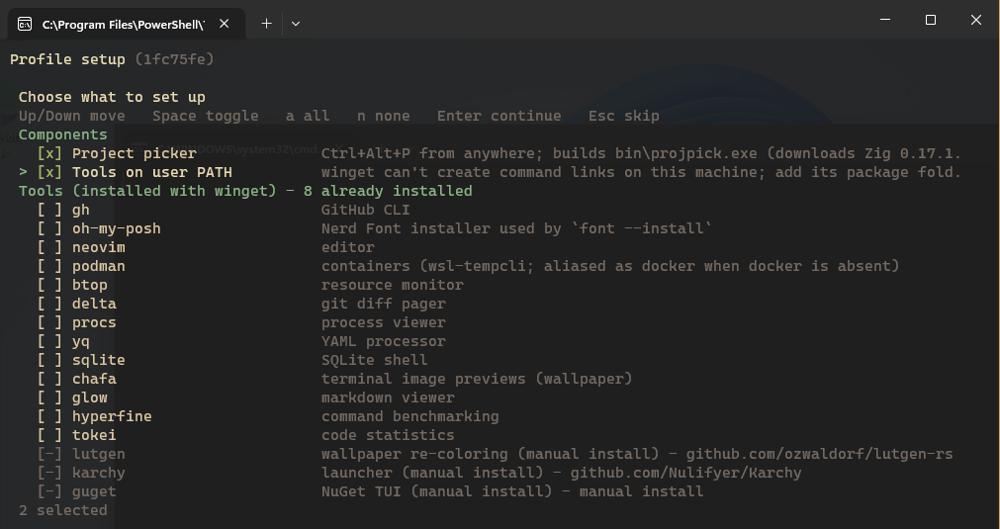

# Getting started

## Install

You need PowerShell 7 and Git. If you don't have them yet:

```powershell
winget install Microsoft.PowerShell Git.Git
```

Clone the profile into your PowerShell folder:

```powershell
git clone https://github.com/Nulifyer/powershell-profile.git "$HOME\Documents\PowerShell"
```

If your Documents folder is redirected (OneDrive, a network share), clone into wherever `$PROFILE` points instead:

```powershell
git clone https://github.com/Nulifyer/powershell-profile.git (Split-Path $PROFILE)
```

## First run

Open a new PowerShell 7 terminal. Before the first prompt you'll see:

```
Profile setup — first run (1fc75fe). Runs once per update; 'profile-setup' reviews choices.
```

followed by a checklist:



| Key | Action |
|-----|--------|
| <kbd>↑</kbd> / <kbd>↓</kbd> | Move |
| <kbd>Space</kbd> | Tick or untick |
| <kbd>a</kbd> / <kbd>n</kbd> | Tick all / none |
| <kbd>Enter</kbd> | Go |
| <kbd>Esc</kbd> | Decide later (you'll be asked again after the next update) |

What's in the list:

- **Project picker**: the <kbd>Ctrl</kbd>+<kbd>Alt</kbd>+<kbd>P</kbd> project switcher. Setup builds it from source; the first build downloads Zig (about 100 MB, once) and takes about a minute.
- **Tools on user PATH**: only matters if winget can't create command links on your machine (common on company laptops). It's pre-ticked when that's the case. See [Setup and tools](setup.md#winget-on-locked-down-machines).
- **Tools**: optional command-line tools you don't have yet, installed with winget. The ones the profile uses directly (fzf, fd, ripgrep, eza, bat, git) are pre-ticked.
- **Cleanup**: leftovers from older versions of this profile that might still be yours, such as an old "VSCode Projects" Start menu folder.

After you press Enter, setup works through the list and prints one line per step:

```
  ok   Built bin\projpick.exe
  ok   Project picker ready (Ctrl+Alt+P)
  ok   Installed fzf
  ok   Setup finished in 64.2 s
```

Then the prompt appears. New terminals from now on start in about half a second.

### Fonts

The prompt and `ls` use [Nerd Font](https://www.nerdfonts.com/) icons. Install one and select it with:

```powershell
font --install   # pick fonts to install
font             # pick the terminal font
```

## Updating

```powershell
pu
```

`pu` (`profile-update`) updates PowerShell itself through winget and pulls the latest profile. A plain `git pull` in the profile folder works too.

The next terminal you open runs setup again. Usually that takes a fraction of a second and asks nothing. You only see the checklist when the new version brings something to decide.

The profile also checks for updates by itself once a week, in the background, and tells you at a later prompt:

```
Profile update available (3 new commit(s)). Run 'pu' to pull.
```

## Changing your choices

```powershell
profile-setup
```

shows the full checklist again with your current choices, including tools you declined before. `tools --install` shows just the missing tools.

## Uninstalling

1. Run `profile-setup`, untick **Project picker** and **Tools on user PATH**, and press Enter. This removes the picker from startup and takes out only the PATH entries setup added.
2. Delete the profile folder (`Split-Path $PROFILE`).
3. Delete `%LOCALAPPDATA%\pwsh-profile`, `%LOCALAPPDATA%\projpick` and `%APPDATA%\projpick`.

Tools installed with winget stay installed; remove them with `winget uninstall` if you like.
