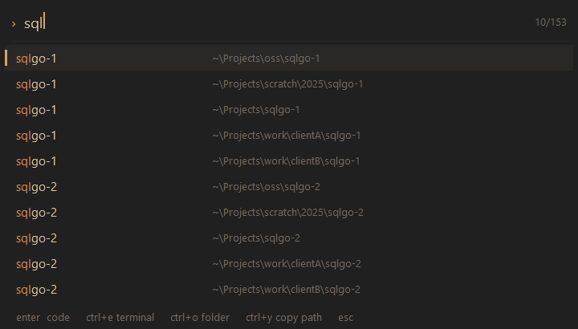

# Project picker

Press <kbd>Ctrl</kbd>+<kbd>Alt</kbd>+<kbd>P</kbd> in any app to open a list of every project on your machine. Type a few letters, press <kbd>Enter</kbd>, and the project opens in your editor.



The shortcut runs through [PowerToys](https://learn.microsoft.com/windows/powertoys/) Keyboard Manager, which `profile-setup` sets up for you (see [How the shortcut works](#how-the-shortcut-works)). The picker opens in about 50 ms.

## Opening projects

| Key | Opens |
|-----|-------|
| <kbd>Enter</kbd> or double-click | Your editor (`code` unless you set another, see [Settings](#settings)) |
| <kbd>Ctrl</kbd>+<kbd>E</kbd> | Windows Terminal in the project folder |
| <kbd>Ctrl</kbd>+<kbd>O</kbd> | The folder in your default file manager |
| <kbd>Ctrl</kbd>+<kbd>Y</kbd> | Nothing; copies the path instead |

Projects you open move to the top of the list next time. All keys are in [Keybindings](keybindings.md#project-picker).

## What counts as a project

- Every folder directly inside `~\Projects` (or `%Z_PROJECTS_ROOT%`). A folder that only *contains* projects, such as `~\Projects\work`, lists the projects inside it instead.
- Any folder under your home folder that contains one of: `.git`, `.hg`, `.svn`, `.jj`, `.vscode`, `.idea`, `.devcontainer`, `package.json`, `deno.json`, `go.mod`, `Cargo.toml`, `pyproject.toml`, `composer.json`, `Gemfile`, `mix.exs`, `pubspec.yaml`, `pom.xml`, `build.gradle`, `CMakeLists.txt`, `flake.nix`, `build.zig`, a `*.sln` file, or a Unity `ProjectSettings` folder.

The search skips dependency and build folders (`node_modules`, `bin`, `obj`, `target`, `dist`, `vendor`, …), dot-folders such as `.cache`, Windows library folders (Downloads, Pictures, Music, …), OneDrive, junctions and symbolic links. It never opens files, so it doesn't download OneDrive files on demand.

The list refreshes in the background when the picker starts and whenever you open it more than two minutes after the last refresh. Press <kbd>Ctrl</kbd>+<kbd>R</kbd> in the picker to refresh right away.

To search more places, add them to `roots=` in the settings file.

## From the shell

The `z` commands use the same list:

```powershell
z api          # jump to "api" (exact name, then prefix, then partial match)
z <Tab>        # complete project names
zi             # pick with fzf
zopen api      # open in your editor
```

When two projects share a name, <kbd>Tab</kbd> offers their full paths.

## Settings

Settings live in `%APPDATA%\projpick\config.ini`. The picker creates the file, with every option commented out, the first time it starts. After changing it, restart the picker:

```powershell
projpick --quit; projpick
```

(`projpick` is available as a command in the shell; the program itself is `bin\projpick.exe` in the profile folder. It starts automatically at sign-in.)

| Setting | Default | Meaning |
|---------|---------|---------|
| `editor` | `%Z_PROJECT_EDITOR%`, else `code` | Command for <kbd>Enter</kbd>. `{path}` is replaced with the project folder; if it's missing, the folder is added at the end. Example: `editor=nvim-qt "{path}"` |
| `terminal` | `wt.exe -d "{path}"` | Command for <kbd>Ctrl</kbd>+<kbd>E</kbd> |
| `projects` | `%Z_PROJECTS_ROOT%`, else `~\Projects` | Folder whose subfolders are all projects |
| `roots` | | More folders to search, separated by `;`, e.g. `D:\src;E:\work` |
| `font` | your terminal font | Font for the picker. By default it uses the font you chose with `font`, or Segoe UI if that isn't installed |
| `font_size` | `15` | Font size in pixels at 100% scaling |
| `rows` | `10` | Visible rows |
| `monitor` | `cursor` | Where to open: `cursor`, `active` (the focused window's monitor) or `primary` |
| `prewarm` | `1` | After sign-in, start PowerShell once in the background so your first terminal opens fast. `0` turns it off |
| `priority` | `normal` | `high` runs the picker at high priority. Measurements showed no benefit, so it's off by default |

Colors follow your [theme](themes.md) automatically.

## Command line

| Command | Description |
|---------|-------------|
| `projpick` | Show the picker (starts it if it isn't running) |
| `projpick --quit` | Stop it until the next sign-in |
| `projpick --install` | Start it at sign-in and start it now (setup does this) |
| `projpick --uninstall` | Stop it and remove it from sign-in |
| `projpick --scan` | Search for projects now and print a summary |
| `projpick --list` | Print the project list (`name<TAB>path`) |
| `projpick --version` | Print the version |

To turn the picker off for good, untick **Project picker** in `profile-setup`.

## How the shortcut works

`projpick.exe` doesn't watch the keyboard: it has no global hotkey, no keyboard hook, and never simulates key presses. Endpoint protection such as CrowdStrike treats those as signs of a keylogger. PowerToys Keyboard Manager, which is signed by Microsoft, owns the shortcut instead.

When you tick **Project picker**, `profile-setup`:

1. installs PowerToys with winget if it's missing;
2. turns on Keyboard Manager if it's off (PowerToys only reads that setting when it starts, so setup restarts it once);
3. adds a Keyboard Manager shortcut: <kbd>Ctrl</kbd>+<kbd>Alt</kbd>+<kbd>P</kbd> → **Start App** `bin\projpick.exe`, **Args** `--show`, **If running** **Show Window**. Your other remaps are kept.

To use different keys, change the shortcut's keys in PowerToys Settings > Keyboard Manager. Setup keeps the keys you choose. Unticking **Project picker** removes the shortcut.

Limits that come from PowerToys:

- The shortcut works only while PowerToys is running. Setup tells you if PowerToys isn't set to start at sign-in (PowerToys > General > **Run at startup**).
- Over administrator windows it works only when PowerToys runs as administrator.
- Now and then Windows refuses to hand focus over (2 of 30 presses in testing). The picker still opens on top; click it, or press the shortcut again.

## If Ctrl+Alt+P doesn't work

- **PowerToys isn't running.** Start it, and turn on **Run at startup** in PowerToys > General.
- **Another remap already uses <kbd>Ctrl</kbd>+<kbd>Alt</kbd>+<kbd>P</kbd>.** Setup says so and leaves it alone. Give the picker other keys in Keyboard Manager: **Start App**, **App** `bin\projpick.exe` in the profile folder, **Args** `--show`, **If running** **Show Window**.
- **The picker isn't running.** Run `projpick`. If it doesn't stay running, check `%LOCALAPPDATA%\projpick\projpick.log`.
- **It isn't installed.** Run `profile-setup` and tick **Project picker**.

Shortcuts never work on the sign-in screen, the lock screen, or a UAC prompt; Windows doesn't allow it.

## Why it's fast

- The window is created once at sign-in and is only shown and hidden. Opening it doesn't start a program or a terminal, and the list is already in memory.
- The background search runs at low CPU and disk priority, so it never competes with you.
