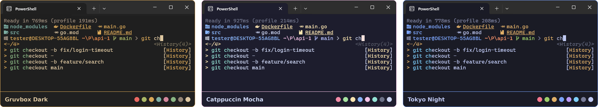

# Themes and fonts



## Themes

```powershell
theme               # pick with a live preview (fzf)
theme gruvbox       # apply directly
theme --list        # list all themes with color swatches
theme --current     # show the active theme
```

One command recolors everything at once:

- terminals: Windows Terminal, Alacritty, Kitty, Ghostty, WezTerm
- VS Code (through a generated theme extension)
- File Pilot
- Chrome, Brave and Vivaldi, through their theme color policy (needs an administrator shell, see below)
- Windows: light or dark mode and the accent color
- Karchy, if installed
- the prompt, in the current terminal and new ones
- the [project picker](project-picker.md)
- your [wallpaper](#wallpapers), if you've set one with `wallpaper`

There are 40 themes, including Gruvbox (the default), Catppuccin (all four flavors), Tokyo Night, Nord, Dracula, Rosé Pine, Kanagawa, Everforest, Solarized, One Dark and Flexoki, with light variants where they exist. They're all defined in `Scripts\_lib\themes\colors.json`.

Some apps only pick up the new colors when restarted.

### Browsers

Chrome, Brave and Vivaldi take their color from a browser policy, and only an administrator can set policies. From a normal shell, `theme` skips them and prints a one-line reminder; everything else is still applied. To include them, run:

```powershell
sudo theme gruvbox
```

The browser builds its whole palette, including light or dark mode, from one seed color. The theme uses its background tinted with its accent (a warm dark brown for Gruvbox), which gives a dark browser in the theme's colors. Restart the browser to see it.

Edge isn't themed: it doesn't support this policy, and shows it as an error on `edge://policy`. If an older version of the profile set it there, `theme` removes it.

### Checking a theme

```powershell
theme-audit              # do all themed apps use the active theme's colors?
theme-contrast           # WCAG contrast check of the active theme
theme-contrast --all     # ... of every theme
```

## Fonts

The prompt, `ls` and the picker footer use [Nerd Font](https://www.nerdfonts.com/) icons. Without one you'll see boxes instead of icons.

```powershell
font --install          # pick Nerd Fonts to install
font                    # pick the terminal font (fzf)
font "CaskaydiaMono NF" # set it directly
font --list             # list installed Nerd Fonts
font --current          # show the current font
```

`font` updates every terminal the profile knows about, the terminal inside VS Code, and the [project picker](project-picker.md). Restart the terminal to see it; the picker switches the next time it opens.

## Wallpapers

```powershell
wallpaper                  # pick one of your wallpapers (fzf)
wallpaper C:\pics\city.jpg # set a specific image
wallpaper browse mountains # search Wallhaven, with previews in the terminal
wallpaper --current        # show the current wallpaper
wallpaper --clear          # stop managing the wallpaper
```

The wallpaper (and lock screen) is recolored to the active theme with [lutgen](https://github.com/ozwaldorf/lutgen-rs), and recolored again whenever you switch themes. Browsing previews need `chafa` (offered by `tools`). For `wallpaper browse`, `-s`/`--sort` picks toplist, favorites, views, date_added or random, and `-r`/`--ratio` overrides the aspect ratio filter.
